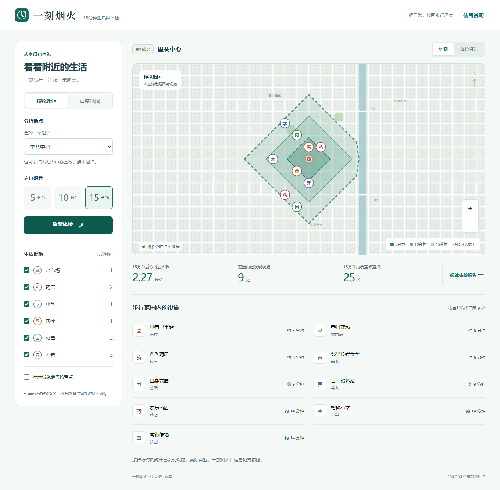

# 一刻烟火

**15分钟生活圈智能体检与规划助手**

从一个社区出发，计算步行能抵达的生活范围，查看买菜、就医、上学与休闲设施，并为待核实的服务缺口留下证据。

参赛方向：2026 上海开源软件应用创新大赛，百度地图“15 分钟生活圈”企业赛题。

## 开发状态

已完成模拟与百度接口体检、真实底图回放、覆盖图表、灰色核查网格、结果保存与报告导出。上海市杨浦区四平路街道抚顺路社区睦邻中心候选点已完成133点原分析、177点局部加密和两组各24点的API对照；实际出入口仍需现场核验。

离线样例使用人工构造的道路图和设施，用于复现算法与界面操作，不代表上海真实道路或设施分布。真实接口结果、现场对照与性能报告的状态见验证记录；不将模拟结果作为真实社区结论。

## 快速运行

需要 Node.js 22.13+，推荐24。私人地点簿使用Node内置SQLite。

```sh
npm ci
npm run dev
```

访问 `http://127.0.0.1:5173`，选择模拟街区并开始体检，无需 AK。

生产预览：`npm run build` 后运行 `npm start`，访问 `http://127.0.0.1:8787`。真实地图需将 `.env.example` 复制为 `.env` 并填入独立的浏览器端、服务端 AK。两种密钥均由服务端保管，网页地图经受限代理加载。

验证：`npm test`执行核心与接口测试；构建后`npm run test:ui`执行浏览器流程；`npm run format:check`检查代码格式；`npm run benchmark:demo`复现合成对照。普通测试和合成对照不调用真实服务。



## 当前功能

- 模拟起点和真实地址选点，5/10/15分钟步行范围。
- 六类设施清单、地图联动、步行时间和1公里覆盖核查点。
- 路网采样与边界加密，多片区轮廓、未知点及采样截断提示。
- 可打印体检报告与JSON导出，桌面和手机布局。
- 六类设施步行时段条形图、三类必需设施覆盖分级、按类别切换的灰色核查网格。
- 最多5份本地记录、结果文件导入和零请求回放，更新失败保留原结果。
- 设施核查台账：来源与依据录入、批量预览、冲突标记、撤销、保存回放和打印附录；不新增接口调用。
- 路线条数限流、预算预检与用量展示、同项目进程互斥、短时缓存、有限重试和取消。
- “我的日常”：5—30分钟个人试算、步速、当地出发时间、可选峰谷等灯假设，复用已有路线、不新增路线调用。
- 私人地点簿、入口地标、到访日期、大字指引、Web朗读与打印；不会把个人小店自动算成已核验公共设施。
- 入口照片、营业时间、收藏搜索和拒绝定位后地址草稿；100米实走步速换算。
- 家人只读地点卡：七天有效、可提前撤销，接收者无需配对，不开放整个地点簿。
- Web与微信开发版共用私人空间、出行偏好及共享报告；一次性设备配对、SQLite持久化、版本冲突保护。
- 出门办事：多任务往返规划、照片熟路卡、分段歇脚路线和假设补点对比。示例可离线运行，私人熟路及休息点随地点簿同步。

[微信小程序开发版](miniprogram/README.md)提供附近地图与清单、10/15/20分钟快捷试算、离线示例和平台适配层。已核验原生模拟器；使用者已反馈原首页手机预览和切换正常，新增功能仍需手机验收，尚未部署或发布。设施核查编辑仍在Web。新增操作和数据边界见[出门办事](docs/outings.md)，实际配置和验收见[微信体验版准备](docs/wechat-experience.md)。

上海24点对照：15分钟加密轮廓与API一致23/24，直线圆为16/24；5分钟加密仅19/24，并未全面优于规则网格。完整协议、误判/漏判及限制见[上海对照实验](docs/experiments/shanghai-comparison.md)。

两轮加密后，另一组预先固定的24个短距离点上，5分钟一致数由20/24变为21/24，漏判减少2个、误判增加1个。改进有限；[复核记录](docs/experiments/shanghai-refinement.md)保留全部计数和调用成本，不将原开发案例当作独立证据。

## 材料导航

现有PDF和视频对应上一轮体检与设施核查功能；本轮日常出行、同步和小程序进展先以代码及设计文档为准，最终参赛录制时统一更新材料。

- [作品介绍 PDF](materials/yike-yanhuo-introduction.pdf)
- [技术与验证报告 PDF](materials/yike-yanhuo-technical-report.pdf)
- [操作演示视频](materials/yike-yanhuo-demo.webm)（无配音，含模拟操作与上海历史结果回放；录制不新增真实调用）

- [验收要求与交付清单](docs/requirements.md)
- [实现计划](docs/roadmap.md)
- [技术设计](docs/architecture.md)
- [百度地图开通与费用说明](docs/baidu-setup.md)
- [安装、验证和部署](docs/deployment.md)
- [本地接口说明](docs/api.md)
- [技术报告](docs/technical-report.md)
- [验证记录](docs/validation.md)
- [报名信息草稿](docs/submission-form.md)
- [演示脚本](docs/demo-script.md)
- [上海案例与验证计划](docs/shanghai-case.md)
- [24点对照实验](docs/experiments/shanghai-comparison.md)
- [设施清洗与多源合并策略](docs/poi-cleaning.md)
- [界面设计约定](docs/frontend/DESIGN.md)
- [日常出行与双端设计](docs/daily-life-design.md)
- [微信小程序联调说明](miniprogram/README.md)
- [开发记录](CHANGELOG.md)

开发仓库暂为私有；提交参赛材料前需落实评审可访问方式和开源发布。

## 许可证

项目自有代码采用 MIT 许可证。百度地图服务、地图数据和依赖库遵循各自的授权条款；项目许可证不授予地图数据再分发权。
