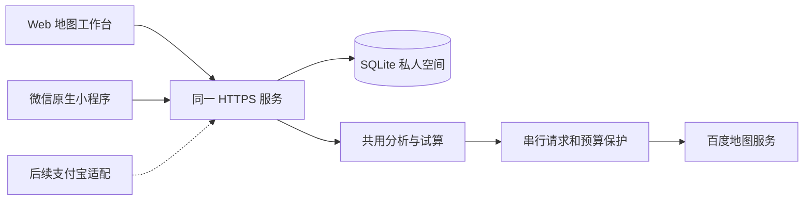

# 从生活圈体检到日常出行工具

更新：2026-10-05。微信先行，保留支付宝适配边界。

## 使用者与任务

居民需要回答“按我的步速，现在走一会儿能到哪里”；家属和社区人员需要替不熟悉手机的老人找到地点，并留下能带出门的指引。地点、入口、个人出行偏好和体检结果由同一服务管理，两端通过设备配对访问同一个私人空间。初版不用微信身份作为数据库主键，后续接入微信或支付宝登录时，将平台身份映射到空间成员，不改变业务数据结构。

## 当前已实现的方案

| 场景 | 操作与结果 | 边界 |
|---|---|---|
| 老人不会用手机 | 家属或社区人员代查、录入入口地标；Web生成大字卡片、朗读和打印；微信显示同一地点的大字卡片 | 老人不需要注册；朗读依赖浏览器语音支持。卡片是地址和地标指引，尚非逐路口导航 |
| 小店未被百度收录 | 主动“记住这个地方”，保存名称、坐标类型、详细地址、入口地标、到访日期和提醒 | 私人记录，不是平台认证；不持续跟踪，不自动加入公共设施覆盖统计 |
| 不同步速与时间预算 | 支持5—30分钟整数时长、0.3—2米/秒步速、当地出发时间 | 复用已有路线距离试算，未重新寻优路线；超出采样边界明确提示 |
| 高峰与平峰等灯不同 | 可设置路口密度、峰谷平均等待、早晚高峰窗口；每个假设路口按抵达时刻选择等待时长 | 均为用户假设，不是实际附近路口或实时灯态；不声称识别了实际路口 |
| 两端互通 | 地点簿和出行偏好同步；最多5份私人共享报告可互相打开；SQLite持久保存 | 手动同步，版本冲突返回409。两端未做到所有界面功能一致 |

## 出行时间模型

原报告继续保存接口原始耗时和生成时间；试算为单独结果，`scenario`保存偏好、来源报告编号和试算时间，`recordedSeconds`保留原始耗时。

`试算时间 = 路线距离 / 个人步速 + 假设路口等待总和`。

不先缩放接口总耗时再叠加完整等待，以免重复计时。开关关闭时是“未计入等灯”，不能解释成“实测不需要等灯”。开关打开时，把路口按每公里密度均匀放置在已有路径距离上；每到一个路口，用出发时刻加已行走时间和此前累计等待求抵达时刻，判断是否在用户设定的高峰窗口。窗口左闭右开，支持跨午夜；当前不区分工作日和节假日。峰谷窗口的硬切换是期望等待的简化情景，不能当作真实交通信号周期或严格FIFO路网模型。

轮廓仅使用原网格和已有两轮中点，保留未知点空白，不从直线圆外推。较长时间预算不会偷偷增加采样或百度调用。所有自定时长、步速和峰谷范围目前只有合成与契约测试，尚无上海真实步行者的准确率证据；旧5/10/15分钟API对照不能用于证明新个性化模型的精度。

## 为什么暂不直接接实时红绿灯

[百度红绿灯倒计时官方文档](https://lbsyun.baidu.com/docs/webapi?title=lamp_service/countlight/base)将产品描述为驾车服务，并说明是需要申请的高级服务。现有步行矩阵没有提供路径上的行人过街方向和配时，不能凭AK已开通推断有行人信号数据。

下一阶段的实测数据对象需包含：路口与过街方向、坐标系、行人相位、周期、时段、工作日类型、采集时间、有效期和来源。必须先把步行路线与实际过街边关联，再按到达时刻计算等待。缺失资料使用有标记的区间估计；不把机动车绿灯等同行人可以通行。若只能得到若干次观察，应保留样本量和范围，不输出伪精确倒计时。

## 双端架构

`src/shared/journey.ts`和`life.ts`是业务契约来源；小程序构建从这些源文件产生CommonJS模块，避免两套验证规则。`miniprogram/platform/`隔离请求、设备存储、位置选择和剪贴板；支付宝文件只是适配预备代码，未验证小程序框架、权限和HTTP方法差异。

微信位置选择记录GCJ-02；Web百度位置记录BD-09；模拟位置明确用局部平面坐标。存储与同步保持原坐标类型。将GCJ-02或WGS84地点用于百度分析时，用户主动操作才调用既有受限坐标转换接口，不能直接将两种坐标混用。微信现已接入原生底图、轮廓、设施点与清单联动；显示时本地近似转换BD-09为GCJ-02，空洞仅画边线，仍需真机与现场对齐核验。设施核查编辑继续由Web提供。

## 私人空间与冲突

- Web使用HttpOnly、SameSite=Strict会话；外部部署附加Secure。小程序保存仅用于本服务的设备令牌，不存百度AK。
- 服务端只保存令牌哈希。配对码5分钟有效、仅一次使用，生成新码作废旧码；有请求频率限制。设备会话30天到期，每个空间最多12个有效设备。
- 配对代表可以读写整个私人空间。单地点只读分享使用独立随机令牌，七天有效、可撤销，不能作为设备令牌访问地点簿；每个空间最多20张有效卡。分享内容是创建时副本，不随地点簿修改自动变化。社区协助者的细粒度成员角色仍未实现。
- SQLite更新使用版本条件，冲突保留本机草稿。读取后先预览，用户可以替换或合并；合并同编号记录及偏好明确保留本机值，随后另行同步。离线删除后选择合并可能重新引入服务器旧记录，需核对再移除并同步；尚无自动三方合并与删除墓碑。
- 服务器地址变化不携带旧设备令牌。私人备份可由用户自行下载；`.data/`、密钥、开发者工具私人配置排除Git和Docker构建上下文。
- 当前是邀请制、单实例、家庭/小组试用方案。没有微信登录、全设备撤销控制台、账号找回、分布式配额或公开自助注册。不要将设备配对描述成已经完成的微信账号体系。

## 后续落地顺序与验收

1. **微信真机试用**：配置实际AppID、隐私声明、位置接口权限和HTTPS域名；在安卓与iOS各验证位置授权拒绝、断网草稿、同步冲突、大字卡和任务取消。没有AppID和设备验证前不称已发布。
2. **老人线下指引**：选上海社区的药店、菜场和小店各一处，与老人或协助者走一遍；补充实拍入口、可辨地标、台阶与休息点。得到真实路线步骤后再做大字逐步导航与语音。Web可由社区前台代查、打印；电话求助流程由社区提供真实联系人后再设计，不虚构服务能力。
3. **实测步速与信号**：已加入100米实走用时换算，明确排除等灯与停歇；下一步选择少量实际人行过街点，跨早高峰/平峰重复记录，以未参与调参的路线验证到达误差、10/15/20分钟误判与漏判。
4. **小程序地图与支付宝**：核验已实现的微信底图、轮廓叠加、地图选点和目的地打开；逐路口指引仍需真实路线步骤。之后实现支付宝页面配置与权限验证，复用既有API和共享业务模型。新增相机、照片压缩、隐私弹窗和卡片跳转尚未适配支付宝。
5. **公共补充与治理**：用户明确同意后才把个人小店提交为待核查设施，保留来源、去重、复核和下架流程。公开统计必须将个人记忆与已核验公共设施分开。

## 当前验证方式

自动测试覆盖步速与时长边界、到达时刻跨时段/午夜、无重复叠加、未知点、旧文件兼容、坐标声明、空间隔离、配对失效/复用、版本冲突、重启持久化、私有报告访问，以及微信业务代码通过真实本地HTTP服务与Web会话互通。微信测试用模拟平台回调执行实际页面代码，不等同于开发者工具渲染或真机验收。Web另做桌面、390像素手机与打印截图审查。本轮自动测试不读取AK、不调用百度。

界面证据：[桌面日常页面](images/daily-life-desktop.png)、[390像素手机页面](images/daily-life-mobile.png)、[大字卡打印视图](images/assisted-card-print.png)。截图中小店是构造的模拟记录。

## 2026-10-08 日常使用增强

小程序主入口改为附近、地点簿、我的。首次无服务器时使用构建内的离线街区，不伪装真实社区；10/15/20分钟切换与自定义步速调用同一核心算法，不增加百度请求。上次报告在容量允许时保存到设备，较大报告引导回Web打开。

记店先填名称与入口位置，再按需补充照片、地标、营业时间和提醒。位置未选定时可保存地址草稿；编辑其他地点前确认替换草稿。收藏和关键词搜索帮助找回常去地点。照片最长边480像素，约48KB以内，整个地点簿最大750KB；Web编辑保留所有新增字段，小程序将照片较多的状态拆为有界更新。

家人卡片可以复制文字、由Web朗读或打印，也可以经确认后生成只读分享。打开真实目的地交给微信内置地图；模拟地点和未支持转换的坐标不会进入真实导航。协议、相机、地图与转发的实际兼容性继续按[体验版验收](wechat-experience.md)验证。
