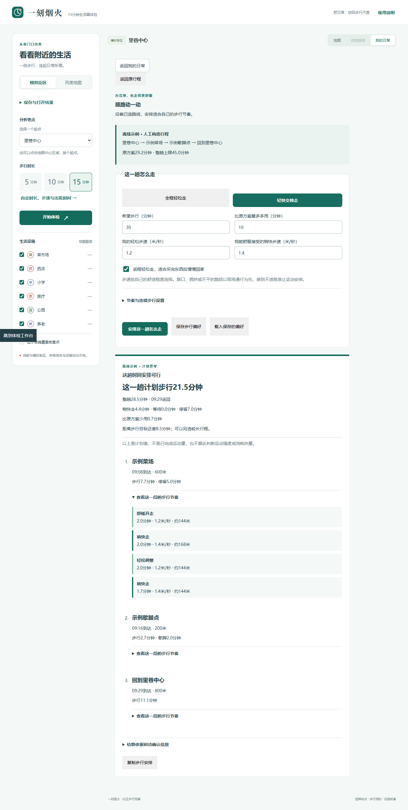

# 顺路动一动

买菜、取东西或办事时，沿已选行程安排轻松走与稍快走，并重新核对能否按时返回。Web与微信使用同一套计算，不增加百度请求；步行偏好可通过现有私人地点簿同步。

## 怎么使用

Web进入“我的日常 → 出门办事 · 熟路与歇脚”；微信进入“附近 → 出门办事”。可以先点“顺路动一动 · 先看离线示例”，或算出办事／购物方案后点“这趟顺路动一动”。

1. 选择全程轻松走，或轻快交替走。轻松步速默认沿用个人步速；稍快步速需要自己觉得舒适。
2. 填写希望步行多久、比原方案最多多用多久。勾选“返程轻松走”后，最后一段始终使用轻松步速，便于购物后回家。
3. 需要时展开节奏设置，调整开头轻松走、每次稍快走与恢复时长，以及连续步行上限。
4. 点击“安排这一趟怎么走”，查看计划步行分钟数、稍快走分钟数、等待、停留与返回时刻。展开路段查看时间与距离安排；完整且满足约束时可复制文字。
5. “保存步行偏好”写入地点簿，随后可手动同步。未保存的输入只留在当前设备草稿中；载入同步后的偏好会先询问是否替换草稿。

没有可行安排时，页面说明是营业时段、整趟时间、额外时间还是连续步行超过限制。希望走30分钟但这条路只有21.5分钟时，显示还差8.5分钟；不会凭空加一段道路，也不会要求加快步速来补足时长。

## 算法与数据范围

`src/shared/movement.ts`接受原方案的有向路段距离、地点顺序、出发时刻、停留、营业窗口和可选的已核验休息点。快慢交替以实际计划步行秒数累计，等灯、等开门和购物停留不推进运动节奏。每个阶段使用自己的距离／步速，最后重新累计整趟时间，而非缩放原来的总耗时。

等灯仍是使用者输入的均匀路口密度与峰谷等待假设，按到达假设路口的时刻加上此前等待选择等待值，支持跨午夜；没有真实行人信号或现场路口数据。改变步速后再次核对营业窗口，含返程，并检查原行程时间预算与允许的额外时间。

连续步行只在原行程含有效核验记录、且停留至少1分钟的歇脚点重置。商店停留和红灯等待不视为坐下休息。过期核验保留提示但不重置；可回购物方案选择已核验歇脚点后重算。当前不会自动寻找新的休息点。

输入范围：步速0.3—2米／秒；希望步行1—90分钟；额外时间0—60分钟；开始轻松走0—10分钟；每段稍快／恢复1—10分钟；连续上限0—60分钟，0表示不设置。原行程含2—6个到达站点，最后一个必须是无停留的返程站；不更改地点顺序。限值是本产品的计算边界，不是健康建议。

计划值不能作为已经完成的运动记录。当前没有GPS跟踪、心率、卡路里估计或健康强度判定；路段分段是步行节奏示意，不是逐路口导航。路口、拥挤与不平路面按现场情况通行；个人舒适度优先。相对运动强度因人而异，不能仅从一个速度推定，设计参考[CDC的相对强度说明](https://www.cdc.gov/physical-activity-basics/measuring/index.html)。

## 可复现的离线案例

示例从里巷中心出发，600米到示例菜场、停留5分钟，再走200米到示例歇脚点、歇2分钟，最后800米回去。原方案按1.2米／秒计算约29.2分钟，整趟上限45分钟，09:00出发，关闭等灯假设。

选择交替走，轻松1.2米／秒、稍快1.4米／秒、开头2分钟轻松、稍快与恢复各2分钟、返程轻松：得到计划步行约21.5分钟，其中稍快约4.4分钟；等待0、停留7分钟，整趟约28.5分钟，09:29返回。所有地点和距离都是构造示例，不代表上海实测运动量。

[Web手机布局](images/movement-mobile.png) · [微信原生结果](images/mini-movement-result.jpg) · [微信大字节奏](images/mini-movement-large.jpg) · [微信大字设置](images/mini-movement-settings.jpg)

90项业务／接口／小程序测试与11项浏览器流程通过。测试覆盖分段距离与耗时守恒、快慢切换边界、到达时刻跨峰谷、营业窗口与午夜、有效／过期歇脚、目标不足、无效输入、草稿恢复、保存失败、两端HTTP同步及冲突保护。Web检查桌面、390及320像素；原生微信通过官方项目接口验证入口、购物行程传入、计算、大字表单、节奏展开和控制台，没有使用鼠标键盘控制。新增页面的手机和实际街道体验仍待验证。

AI的接入选择见[规划助手设计](planning-assistant.md)；本轮计算不调用大模型。
