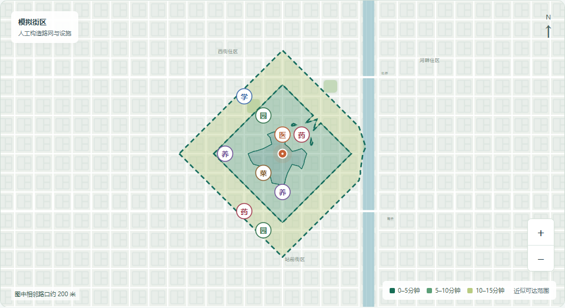
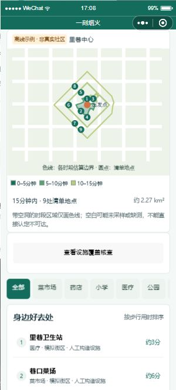

# 验证记录

## 2026-10-16 定向补核查与结果说明

- 完整221项业务/API/原生页面回归与40项浏览器流程通过，构建通过。既有开发者工具私人配置保留未提交。
- 以独立距离检查核验完整局部查询的负向证据边界，多个不完整或不足范围不能拼成“完整”；保留孔洞/距离带、原类别完整性与基础时间。位置差异添加待核实记录，旧报告不变。
- 受控上游验证只请求所选类别、共享网关缓存与额度、预算不足前置拒绝、重复请求同任务、空间隔离、取消后丢弃迟到响应。它们是协议测试，不是真实百度调用。
- Web实际导出前后JSON交由Node校验摘要、数据数量、来源与面积守恒；备份失败时保留原报告和待采用结果，刷新浏览器后可恢复已保存备份。新增320/390像素截图检查，无水平溢出。
- 原生实际页面业务测试覆盖离线执行、明确采用、备份失败、重新打开、上下文失效和取消。官方CLI确认模拟器标准/大字结果，观察到构造演练176→177有效点、待核查0.848→0.210、范围2.241→2.271平方公里；不能将其描述为真实社区改善。刷新后的首次自动化响应超时，读取当前页确认就绪后继续，没有提高业务调用超时。
- 发现并修正小程序环境缺少structuredClone导致演练不可用，以及原生紧凑按钮的标题/段落显示问题；使用可移植JSON复制并目视复核截图。控制台error筛选无匹配，不等同于证明所有设备均无错误。
- 本轮百度、AI、语音真实业务调用均为0；未更新旧提交PDF和视频。操作、复现与后续边界见[定向补核查](targeted-verification.md)。

## 2026-10-16 设施补点方案比较

- 完整业务/API/原生页面测试208项通过，浏览器流程38项通过；生产构建与格式检查通过，开发者工具既有`project.config.json`单独保留。沙箱临时文件重命名导致两项旧配额测试失败，改用正常用户环境同套测试全过，没有修改配额逻辑。
- 七方案、相同数量排序、重复覆盖扣除、未知不计收益、距离边界、检索范围、孔洞及原报告不变均验证。四个固定构造场景共163,996个点与方案组合检查，三类错误均为0；它们来自重复方案检查，不是同等数量的实地点。完整输入见[构造验证](experiments/facility-siting-simulation.md)。
- Web验证320/390像素、输入失效、重复点恢复、前后切换及自包含导出；浏览器导出交给Node复算，面积差小于0.001平方米。跨运行时观测到约5.8e-11平方米的末位浮点差异，使用明确数值容差；该容差不表示真实地图精度。
- 原生页面自动测试验证七方案共享计算及带来源的复制摘要；微信官方命令行检查标准/大字页面、两个位置的单点和组合方案，以及自动滚到结果图。标准/大字截图经过目视核验，控制台错误筛选无匹配。临时构造场景没有写入私人地点簿；不使用桌面控制，手机和现场选址验收仍待完成。
- 本轮百度、模型、语音业务调用均为0；比较复用已有报告，无新依赖。增强前基线及材料校验已保存，旧PDF与视频未覆盖。使用和约60秒待录制分镜见[补点方案比较](facility-siting.md)。

## 2026-10-16 连续设施分区与百度评分修订

- 功能基线`921127e`，按百度40/30/15/15优先补R04：分类距离覆盖从离散点扩展为连续区域和面积；复用已有步行轮廓，保留孔洞、断开区域、圈外设施影响与检索不足，不用未取全结果证明缺口。
- 128边距离近似使用内外边界和数值余量，保留带归待核查。构造几何对照4组、23,428点，无错误已覆盖、错误缺口或未分类点，面积守恒误差小于0.001平方米；该结果不是社区设施或路网的现场准确率。
- 上海2026-10-05报告本地回放，15分钟轮廓约1.761平方公里，三个类别均有覆盖当前全域的正向证据，候选缺口0；类别未取全与入口待核验的事实保留。保存来源SHA-256，不重复发送百度请求。
- 本机201项业务测试通过；全量浏览器首次36/37，发现旧“数据不足”图例说明被替换，修复语义后工作台与新增流程5/5。最终同一功能提交的[独立CI](https://github.com/TingxuanHan/yike-yanhuo/actions/runs/38842588561)完成格式、构建、201项业务和37项浏览器流程，全部通过。
- Web320/390像素无水平溢出、导出自包含、失败清理旧分区；微信官方CLI编译并检查标准/大字截图。修正大字行的样式选择器，重新编译后读取到实际`display:block`，面积名称与数值分行。模拟器错误日志无匹配；结束后恢复本机页面与偏好，没有接管鼠标键盘。
- 百度、模型、语音外部业务调用均为0，并发、额度和密钥配置未改。按本机已配凭据值检查源码、构建物及Git历史无命中，配置未跟踪；开发者工具既有`project.config.json`修改保留不提交。新增手机和现场验收待完成。

使用、公式与复现：[连续设施分区](coverage-area.md)。本轮评分文档采用百度任务书，原v1发布附件保留历史版本；材料更新见[交付索引](submission-guide.md)。

## 2026-10-16 实走校准与前瞻验证

- 两端新增准备预测、后补实际、扣除停留、历史中位数建议、后续成对误差及显式采用。本人填报、地图估算和模拟练习分开；数据不足、过期、异常与不同走法不进入建议。训练记录不计作自己的验证，历史引用必须早于预测且与当时建议一致。
- 配对HTTP往返保留原始预测和来源；另一私人空间不可读。旧未完成副本不能覆盖已完成记录，不同补记返回合并错误；409保留旧版本保护。存储失败保留表单，排除可恢复。备份后清空需用户确认，日常步速和其他记录不变。
- 193项业务/HTTP/原生页面测试和36项浏览器流程通过；最后备份清空及显示微调再通过9项相关业务和2项浏览器测试。生产构建、改动格式检查通过；原有开发者工具`project.config.json`保留未提交。沙箱临时目录的两项额度重命名测试遇到Windows权限问题，正常用户环境同套测试通过，额度逻辑未修改。
- 远端首次回归在原有家人协助流程超时：失败画面显示，脚本在刷新返回前填写建议，触发了正确的过期草稿保护。改为等待建议送达及双方刷新完成，再编辑下一条；撤销等待终止提示。新增延迟刷新测试确认旧草稿保留、拒绝发送、主动重新核对后采用新版本。9项协助业务测试通过，同一浏览器流程连续3次通过；没有放宽超时或关闭草稿保护。
- Web320/390像素、导出、取消清空和错误恢复通过；微信CLI真实编译器打开新增原生页面，检查大字显示。原生结果截图仅用明确标注的构造页面状态，未写入真实私人地点簿，结束后恢复页面本机状态。
- 四组固定构造对照保留稳定、停留、走法改变与历史不一致场景。走法改变时建议可劣于基线，保留完整结果，不宣称普遍改善。数据和命令见[构造对照](experiments/walk-calibration-simulation.md)。
- 百度、文本模型、语音及其他外部业务接口调用均为0；未改并发或API额度。新增页面实体手机、实际路长与时间仍待使用者验证。增加独立2页补充PDF，`os2026-submission-v1`标签、视频及发布附件保持原样。

使用、算法、数据格式与评分映射见[实走校准](walk-calibration.md)。

## 2026-10-15—16 入口提醒、备选比较与录制彩排

生产构建通过；完整回归184项核心／接口／微信业务代码测试、34项浏览器流程通过。收尾补充确认窗口超过5分钟失效的检查后，6项备选相关测试再次通过。原先已走地点与事件、取消后的原行程、缺失道路、坐标变化、错类别、过远入口、同步偏好、未知价格、旧出门卡失效和换店后的常用方案建议均有检查。新功能仍未完成手机与街道实走。

浏览器验证390／320像素、明确确认与取消、反馈入口名称和方向、不同空间的相反观察、卡片更新。窄屏截图及录屏关键画面经过目视检查；未发现横向溢出。微信官方工具完成WXML编译及新增“我的通行需要”入口截图。生成目录原先在构建期间删除会影响工具模块索引，现保留该目录；重开项目窗口后能读取新增模块。自动化方法调用仍遇到连接超时，因此本轮不把原生入口截图或业务代码测试称为完整原生交互验收。没有清除登录和私人存储，也未接管鼠标键盘。

2026-10-15 23:38（UTC+8）独立服务复用原有额度台账，串行验证上海抚顺路社区至两个菜市场的候选比较及步行指引：原往返410米，备选往返496米，备选去程248米／地图参考232秒／3条指引／18个路径点。实际路线调用5次，搜索、底图、其他调用均为0；重复比较与指引命中缓存。入口、营业、无障碍和街道通行未现场核实。详见[实测记录](validation/baidu-alternative-live.json)。

16段Web录屏使用无密钥独立服务、新会话和构造反馈，最后回放已保存的真实API结果。正常录制和最终快速彩排均为0次外部／付费接口尝试、0个浏览器页面异常。MP4为1600×900、约148.56秒、约5.3MB，带画面字幕，无音轨；附SRT、时间线、配音稿及示例离线卡。它是Web彩排，不替代手机录像或现场证据。参见[录制说明](recording-guide.md)。

工作区、构建产物和Git历史按本机配置中的三项密钥值检查，无匹配；`.env`未跟踪。本轮保持原有百度串行和额度，开发者工具已有的`project.config.json`修改保留在本机、不纳入提交。未开通云资源、上传小程序、公开仓库或提交参赛材料。

## 2026-10-15 邻里提醒与跨用户观察

- Web地点详情、行程步行指引及微信原生组件接入同一提醒服务。两个独立空间完成报告、支持、恢复分歧、刷新和撤回；同空间设备只保留一份最新反馈，返回结果不包含他人空间或设备令牌。
- 验证观察时间有效期、转述不计入亲见支持、冲突不自动覆盖、过期不视作恢复、本人撤回、模拟与真实坐标隔离、目标及折线邻近、WGS输入使用实际返回坐标、缺失／断裂路径拒绝拼接。
- 检查鉴权、来源保护、明确分享、版本冲突、幂等请求、重启持久化及限流。网络写入成功但响应丢失时，恢复本机草稿并重新同意分享仍复用请求编号；每日共享额度耗尽后仍可撤回本人反馈。
- 完整业务／HTTP／原生业务代码测试178项、浏览器流程33项通过；生产构建通过。代码格式检查除明确保留的本机`project.config.json`外通过。界面覆盖320像素、恢复草稿、失败保留、台阶筛选、时间过期与原有简易家人流程。
- 微信官方编译器发现并修复新增WXML条件表达式转义错误；清理代码编译缓存后从实际页面执行模拟行程流程，原生组件可正常挂载。标准／大字布局及反馈依据展开通过模拟器检查；自动化参数跨运行环境传递的数组不用于替代真实页面计算。截图中的反馈均为构造数据，不是实际街道事件。
- 本轮百度、模型与语音真实调用为0，未新增并发或收费渠道。没有部署云服务、发布小程序或改变仓库可见性；新增功能的实体手机、现场通行和跨网络验收仍待完成。开发者工具仍有原有录音声明配置警告，不能据此认定完整发布验收通过。

操作与边界见[邻里提醒](neighborhood-notices.md)。界面证据：[Web320像素](images/neighborhood-conflict-320.png)、[微信标准模式](images/neighborhood-mini.png)、[微信大字模式](images/neighborhood-large-mini.png)。

## 2026-10-15 个人条件对比、复核日期与手机布局

- 两端比较同一份报告、同一时长的步速及等灯假设，保留原始路线距离、测时和来源。对比输出共同／减少／增加范围与逐设施名单；检查面积分区守恒、相同条件零变化、缺测、停用及冲突排除、不同分钟数和不完整网格拒绝。手动等待不是附近真实行人信号。
- 复核日期作为可选字段参与报告与核查文件往返，旧报告兼容。按同来源同编号的最新记录生成到期与7天内任务；历史结论、原始轮廓和用量保持不变。测试到期边界、更新替代旧提醒、跨来源冲突、无日期、非法日期、导出与撤销。
- 修复小程序恢复历史报告时依赖TextEncoder的兼容问题，使用已有跨端字节计数。实际页面代码在无TextEncoder的测试运行时可读回含复核记录的报告，退出演示后存储与原报告不变。
- 手机演示先显示地图与时长，将地点、核查、对比分开；参数按需打开。320／390像素无横向溢出，键盘可切换与恢复焦点；原有简易模式和家人流程通过回归。
- 生产构建、170项业务／HTTP／原生页面业务测试、32项浏览器流程通过。微信官方CLI实测社区页面、条件比较及大字结果；一次自动化连接超时后按顺序重试成功，最终控制台未返回错误。截图为构造数据，不能作为上海实走证据。
- 本轮真实百度、模型及语音接口调用均为0。没有部署云服务、发布小程序或改动私有仓库可见性。新功能手机实走、现场设施核验和跨网络联调仍待完成；已有PDF与视频尚未按本轮功能重新制作。

界面证据：[390像素](images/community-mobile-390.png)、[320像素](images/community-mobile-320.png)、[桌面](images/community-desktop.png)、[微信社区页](images/community-compact-mini.png)、[微信条件对比](images/comparison-mini.png)。

## 2026-10-15 社区演示、逐点依据与时间色带

- Web与微信增加社区体检演示入口，串联范围、设施核查和报告。微信退出恢复原报告与个人偏好；上海133点版本的24点对照只作为独立实验摘要，完整保留5/10/15分钟结果和未现场核验说明。
- 覆盖详情区分已找到设施、检索未发现与数据不足，展示最近已检索设施的直线距离、检索完整性、1000米核查范围及记录时间。Web点击／键盘和微信选择器查看相同证据。修复较短时长的灰色网格错误使用更长时长点位的问题。
- 时间色带按已有轮廓求交和差集，限定在当前时长范围内；测试验证总面积、相邻色带无重叠、空洞保留、非嵌套输入和空范围。微信带空洞的区域只画色线，避免填成已知可达区域。
- 生产构建、163项业务／HTTP／原生页面业务测试、29项浏览器流程通过。受限临时目录中的两项配额文件替换测试曾报权限错误，在正常用户环境复验同一套测试全部通过；未改配额逻辑。代码格式除开发者工具原有的`project.config.json`修改外全部通过，本机配置保持未提交。
- 浏览器覆盖模拟演示、报告导入／导出、错误保留原结果、地图点位选择、短时长切换和320像素布局。通过微信官方CLI读取原生页面和截图，使用构造数据，不接管鼠标键盘。此检查不等于新增功能的实体手机或上海街道验收。
- 本轮真实百度、文本模型、语音识别调用均为0，未改变并发、预算或部署设置。原有PDF和视频未重录，新演示操作见[演示脚本](demo-script.md)。

## 2026-10-15 分段指引与真实接口回归

157项业务、HTTP与小程序原生页面业务测试通过；25项浏览器流程通过，新增35秒客户端超时后定向复验步行与离线导出流程通过。生产构建与代码格式通过，本机`project.config.json`保持未提交。新增文字步骤、缓存、模拟路网、离线卡、鉴权及输入校验边界见[分段步行指引](walking-guides.md)。

上海公开地点实测：北京时间02:39，抚顺路社区睦邻中心至阳普鞍山菜市场返回205米、194秒、4条指引。一次实际百度步行请求成功，第二次相同接口请求命中网关缓存；检索、转换、底图调用均为0。未增加并发或日额度。现场入口、施工与实际用时没有实走验证。

真实合成语音链路最终通过：录音→显式发送→可编辑文字→确认→Qwen修改条件→确认→本机核算。每次模型请求前读取[硅基流动官方价格数据](https://www.siliconflow.cn/pricing)，成功轮的`FunAudioLLM/SenseVoiceSmall`及`Qwen/Qwen3-8B`均通过零价格检查；没有切换付费服务。识别句中“药”被识别为“要”，保留人工核对步骤，文本规划仍正确应用30元、45分钟及取消取药，并保留原购物清单。该测试使用本地合成音频，不接入真实麦克风。

首轮识别测试在30秒等待上限内未收到响应；将测试脚本等待改为45秒，服务端30秒保护不变，第二轮通过。测试台账共记录2次识别尝试和1次文本规划；首轮的上游结果未确认，不作为识别成功或费用记录。成功轮识别与文本各1次，百度调用0次。不依据单次超时判断模型能力。

微信官方CLI已恢复连接并验证原生大字步骤排版，截图使用构造数据，未改动真实地点簿；错误日志筛选无匹配。业务测试模拟系统回调，截图只作原生布局证据，新功能实体手机、权限与街道实走仍待验证。没有云部署、上传、公开发布或更换本机AK。

## 2026-10-14 常用方案、出门准备与家人回执

Web与微信新增常用出门条件、含返程地点的本机准备卡，以及限时位置卡上的家人主动回应。沿用简易首页三个入口，方案管理、完整依据和沿途资料逐步展开。

- 生产构建、149项业务／HTTP／微信页面业务测试、24项浏览器流程通过。最后补充未出发条件变化的旧卡提示及同步预览数量后，26项相关业务和模板测试、3项出门卡／家人回应／同步浏览器流程再次通过。源码格式检查排除开发者工具原有的本机配置，其余通过。没有更改百度并发或调用预算。
- 常用方案测试覆盖只保存条件、当前步速与时间、不同出发点、缺失地点、容量限制和不自动开始行程。出门卡验证持久化、返程资料、进度改变后过时、提前返程仅保留剩余安排、容量不足保留旧卡，以及可选快捷保存失败不阻止保存行后反馈。
- 实际下载Web离线HTML，断网后用浏览器重新打开，核对返程内容和电话链接，外部资源请求为0。检查用户文字转义、无脚本及无设备凭证。Web320／390像素布局无横向溢出；微信实际JS页面与适配层的重开、准备和复用流程通过。
- 两个独立浏览器通过本地无密钥HTTP验证打开不回执、明确填写称呼后回应、本人刷新、断网旧状态、撤销后家人内容消失。服务端与会话测试覆盖专用令牌、来源限制、服务端时间、版本冲突、丢失响应后的同编号重试、替换／到期／撤销。微信真实页面业务代码经模拟平台回调连接同一HTTP协议，未附带设备凭证给家人端。
- 微信官方命令行获取并目视检查原生出门卡和家人回应布局；截图为构造数据，没有实际发送消息。结束检查后恢复首页，不接管鼠标键盘。此证据不等于手机定位、真实通话、离线冷启动或跨网络体验。
- 本轮真实百度、文本模型及语音识别调用均为0，没有云部署或小程序上传。工作区、构建产物及Git历史按三项本机密钥值扫描无匹配，`.env`未跟踪；开发者工具原有`project.config.json`修改保留且不纳入提交。

使用方法和截图见[常用方案与出门准备](departure-preparation.md)。新增功能的手机权限、离线冷启动、实际拨号、跨网络HTTPS与真实街道核验仍待完成；已有PDF和视频未在本轮重录。

## 2026-10-14 简易模式与家人位置线索

Web与微信首次进入默认简易模式，保留常用地点、基本行程和独立联系家人入口。定位在主动点击后单次请求，分享另行确认；拒绝和失败仍可使用电话及最近本人确认记录。新增私有位置卡只读、1小时到期且可撤销。

- 生产构建、全套142项业务／HTTP／微信页面业务测试及22项浏览器流程通过。新增检查包括未来时间、模拟地点、仅计划出发、精度未知、范围随时间扩大及30分钟后停止推测、权限拒绝、页面离开后的迟到定位回调、分享期间撤销、旧卡替换与设备凭证隔离。
- 两个独立浏览器实际通过本地无密钥HTTP服务验证位置卡读取和撤销。Web320／390像素无横向溢出；简易／完整模式切换保留进行中的行程及电话。原有购物、步行、语音、地点簿与行程协助回归全部通过。
- 微信页面的真实JS、共享算法、平台适配层经模拟授权／定位／拨号回调及真实HTTP验证。另用微信官方命令行检查原生简易首页、联系表单和构造位置卡的显示；没有使用鼠标键盘接管。模拟器截图不是手机GPS、实际电话或现场精度验收。
- 本轮新增功能没有实际百度、文本推理或语音识别调用；没有购买云服务或发布。真实手机权限、实际拨号、跨网络HTTPS访问及估算假设的现场核验仍待完成。只保留最近一条本机位置记录，不建立后台轨迹。

截图：[简易首页Web](images/simple-home-390.png)、[微信简易首页](images/simple-home-mini.png)、[微信联系家人](images/family-contact-mini.png)、[Web家人线索](images/family-location-320.png)、[微信构造位置说明](images/family-location-mini.png)。操作与边界见[简易模式与家人位置线索](simple-family.md)。

## 2026-10-14 单次家人协助、入口卡与途中调整

完成Web和原生微信的协助拥有者／家人端。使用隔离SQLite与构造社区数据验证发起、提醒、入口图片标记、本人采纳或拒绝、舒适步速调整、结束及到期；新增功能未调用百度、文本模型或语音接口，未购买云服务、上传小程序或发布。

- 全套134项业务、HTTP接口和微信页面业务测试通过，生产构建通过。浏览器全套19项通过；最后补充结束并发、回执重试及慢请求刷新保护后，重新运行全套业务与浏览器用例均通过。
- 双方浏览器使用独立上下文，家人端没有拥有者Cookie。320／390像素下无横向溢出；建议不会自动应用，照片标记经本人采纳后才保存，步速变化保留已到达事实和原购物预算。结束后家人端无法继续读取或提交，页面清除会话图片；流程没有脚本错误或新增地图／模型请求。
- 微信真实页面JS与适配层连接隔离HTTP服务器，通过分享参数进入家人页；家人端即使已有另一私人空间凭证，也不会把它发给协助服务。验证进度变化后保留编辑草稿、重核、拒绝／采纳、私人入口卡保存删除、结束失效。
- 微信官方命令行在原生模拟器渲染构造的拥有者及家人场景，检查入口标记、建议确认和大字布局；修复了通用卡片样式导致的标记偏移，运行日志没有匹配到错误。该步骤只注入页面显示数据，未更改已保存地点簿；验收后恢复正常行程页。它不等于手机相机、系统分享和跨网络联调已完成。
- 额外覆盖创建／刷新过程中结束且页面隐藏，保证请求完成后仍撤销；确认回执发送失败或响应丢失时，重试不重复应用；异空间访问、未知令牌、恶意来源、过期版本、未知道路、途中位置变化与入口卡超容量合并均被拒绝；慢请求后继续轮询，到期后停止并清空可见内容。
- 三项本机密钥值对工作区、构建产物、微信生成包和Git补丁历史扫描无命中，`.env`未被跟踪。改动源码格式检查通过；全目录检查仅报告开发者工具原有的`project.config.json`格式差异，此文件保持原样且不纳入提交。

构造数据截图：`docs/images/assistance-owner-390.png`、`assistance-helper-320.png`、`assistance-mini-proposal.png`、`assistance-mini-helper.png`和`assistance-mini-helper-photo.png`。照片为纯色测试入口，不代表真实门店或现场证据。

复现：`npm test`、`npm run test:ui -- tests/ui/assistance.spec.ts`和`npm run build`。新增真实手机分享／照片授权、弱网实际体验及远程HTTPS部署仍待验收。单次邀请不包含永久家庭绑定、视频通话、自动通知或后台定位。

首次远端干净构建暴露了小程序共享模块入口遗漏：`trip-adjust.js`在本机残留，干净编译不产生该文件。隔离输出目录复现后，改为编译准备清单中的全部共享模块，构建前仅清理并校验项目内两个生成目录，避免旧产物掩盖缺失。微信契约测试的服务清理提前注册，初始化失败也能释放端口，不再无限等待。修复后重新验证干净生成包及全套测试。

## 2026-10-13 一趟出门、途中记录与语音

整趟核算把购物、办事、步行节奏与返回时间合并，支持有差异预览的条件修改、手动到达／歇脚／取消／返程，以及私人行后记录。业务与接口完整回归125项、浏览器完整流程17项通过；收尾修改后相关27项业务测试和5项浏览器流程再次通过，生产构建通过。新增覆盖缺价与缺路、营业和停留时间、歇脚不抵扣办事时间、明确返回结束时刻、条件保留与清空、草稿恢复、反馈白名单与跨端合并，以及语音权限拒绝、显式上传、可编辑文字、取消和强制截止。

实际免费推理共5次：3次SenseVoice识别、2次Qwen条件修改，百度请求0。前两次本地试跑被来源检查以403拒绝，尚未调用服务商；修正测试服务器端口配置后，第一次识别成功但页面断言找不到文字框，下一次完成识别及修改后卡在商品输入框定位；补齐明确的可访问名称后，最终从录音到整趟核算全部通过。没有把这些测试定位错误归因于模型失败，也未关闭来源检查。

输入为Windows合成普通话“预算改成三十元，药先不取了，四十五分钟内回来”。使用无界面浏览器的合成音频设备，未访问用户麦克风。最终识别文字中的“药”变为“要”，Qwen结合已有条件仍正确改为预算30元、取消取药、保留45分钟和原商品清单；该同音误识别说明仍需文字复核。预算30元不足以覆盖原清单时，程序保留真实的示例报价和超预算提示，不虚构低价方案。每次推理前均核查准确模型官方实时价格为0元，未核验账号账单。

Web检查390与320像素显示、录音到文字确认和完整行程记录。通过微信官方命令接口验证新增原生页面和30.2分钟示例方案，计算后自动定位结果，大字截图已目视检查，控制台error筛选无匹配。仅使用命令接口和无界面浏览器，没有鼠标键盘接管；未触发微信真实麦克风。截图：[Web行程](images/trip-web-result.png)、[微信首屏](images/trip-mini-form.png)、[微信结果](images/trip-mini-result.png)。

语音配置复用后端密钥，录音仅在明确发送后提交，服务器不落音频文件；模型请求共用串行租约。免费价格无法确认时停止调用、异常格式、密钥回显和不响应取消的超时均有测试。最后补测录音启动失败也会关闭已授予的音轨，相关7项业务与5项浏览器用例通过，本轮合计覆盖18项不同浏览器用例。格式检查通过，排除开发者工具已有配置改动；工作区、构建产物和暂存差异按本机三项密钥值扫描无匹配，`.env`未跟踪；开发者工具原有`project.config.json`修改保持不提交。

本轮未开通云环境、上传或公开发布。新增功能仍需真机隐私授权、后台用途声明、环境噪声／方言／弱网测试和真实上海行程采集；模拟器、合成语音与构造路网不证明这些已通过。已有比赛PDF和视频尚未更新到本轮功能。复现和使用步骤见[一趟出门与语音](trip-and-voice.md)。

## 2026-10-05 初版验证

日期：2026-10-05。环境：Windows、Node.js 24.18.0、Microsoft Edge，生产构建产物。

| 检查 | 结果 | 范围与限制 |
| --- | --- | --- |
| TypeScript与生产构建 | 通过 | 客户端和服务端均编译完成 |
| 单元、契约与服务测试 | 49项通过 | 增加共享边细化、无悬挂点、来源冲突、证据导入与统计更新 |
| 浏览器测试 | 6项通过 | 桌面1360px、手机390px、报告导出、错误恢复、无请求结果回放、核查导入/撤销/打印 |
| 视觉检查 | 已检查桌面、手机和上海底图截图 | 上海旧结果叠加，不重新分析 |
| Git同步 | push与fetch通过 | 私有仓库，本地与远程提交核对一致 |
| npm依赖审计 | 安装时0项漏洞 | 本次锁文件对应的检查时点 |
| Docker | 未运行验证 | 已提供构建配置 |
| 增强版视频 | 约90秒，已抽帧检查 | 模拟核查流程与上海177点结果回放，字幕无配音；录制不调用真实服务 |

提交前安全检查已扫描待提交文件、客户端与服务端构建产物、Git历史对象，未匹配到本地两种AK；`.env`未被Git跟踪。模拟截图、PDF页面和视频抽帧均已查看，未发现密钥或开发工具署名。此检查覆盖本项目材料与版本库，不代替账号控制台用量和授权管理。

## 本轮修正

河畔起点测试曾触发多边形合并失败。修正三角片交点的毫米量化，并增加河畔、桥两侧及采样边缘中心回归用例。修正后核心测试和手机完整流程通过。

底图加载实测发现SDK附加的双斜杠和认证路径被代理拒绝，现已规范化路径、补充静态资源与认证路径，同时保持上游固定和分析接口隔离。增加加载前权限预检及两分钟失败缓存，并按真实响应修正顶层`error`字段的解析。相关契约及浏览器失败恢复测试通过；完整底图仍待实测。

地址定位现在按UTF-8字节校验128字节上限，超限时不发出真实请求；权限与配额错误提供对应的配置提示，不透传上游原文。

## 真实接口联调

先前地理编码与地图认证返回240，交叉验证确认是本地两个AK变量位置颠倒：原浏览器变量可通过地理编码，原服务端变量可通过地图认证。已交换本地对应关系；不能将此前错误归因于用户没有开启服务。两种AK和原始鉴权响应均未入库。

2026-10-05北京时间10:15至10:17完成四阶段联调：地址定位、单条步行路线、坐标转换、一轮社区分析全部通过。分析中心为“上海市杨浦区抚顺路社区睦邻中心”的地理编码点，准确入口尚未独立核验。首条路线返回431米、368秒；本轮133/133个测时点有效，累计消耗192条路线、6次地点检索，没有自动重试。192条路线含预检路线，不能视为192个独立验证点。

接口生成的5/10/15分钟近似面积依次约0.174、0.771、1.761平方公里。六类检索均因只取一页而标为不完整，不可据此断言设施缺失；这些数值是接口联调结果，不是现场验证结论。本地结果及摘要保存在被Git忽略的`.cache/live-result.json`和`.cache/live-check.json`。

当日项目本地累计计数为路线192条、检索6次、其他服务5次、地图认证/资源转发16次。该计数不含其他程序，地图资源计数也不等同于平台计费单位，最终用量以控制台为准。原底图检查未形成可见底图；纠正AK后的地图认证通过，但不代替完整渲染与浏览器保密性验证。

## 地点检索并发预警与修正

成功联调后收到账户“地点检索服务并发量接近约定上限”的邮件。旧实现按类别逐条发送，并非同时发出6个检索请求；但非路线服务限速设为3次/秒，最短发送间隔约384毫秒，一秒内仍可能产生3次检索，过于接近个人账户的公开默认上限。旧记录未保存逐请求时间，无法确认百度侧的精确峰值及预警阈值。邮件表述是接近上限，本轮未记录限流失败。

已把本地配置、服务默认值和实测脚本改为：检索至少间隔2000毫秒，路线每次1条、至少间隔1100毫秒；所有业务请求串行至响应读取完成。增加慢响应后不突发补发、排队取消不计量、HTTP 429及业务限流后停止队列的回归测试。真实调用时间只记录固定路径、服务、计量单位和状态码，不记录密钥或查询内容。后续本轮验证使用离线响应，不再新增真实请求。

## 仍需补齐的证据

1. 扩大短范围新点验证和多社区对照；本轮24个新点只提供有限改善证据。
2. 分析中心实际入口现场核验。
3. 设施类别、营业状态与空白候选点独立复核。
4. 最终演示视频、评审访问方式和开源发布确认。

## 真实底图与结果回放增强

北京时间11:01完成保存结果的真实底图回放。上海133点原结果成功显示轮廓与设施，截图已目视检查。10个本地代理资源请求，无失败资源、页面异常或鉴权弹窗，浏览器URL、请求头、请求体、页面和本地文本响应未发现两种AK。SDK日志请求在本地返回204，不转发上游；根路径仍只允许必要的地图显示元数据，检索与算路不能经此代理绕过预算。

新增结果文件导入、下载和浏览器内最多5份记录。打开百度结果默认用无道路底图的坐标示意图，只有主动加载真实底图才请求地图资源。浏览器测试确认导入、保存、刷新后回放和切换时长没有地图、分析、地理编码或转换请求；损坏文件不会覆盖当前结果。导入使用字段白名单并丢弃未知字段，保留原始时间和数据模式。

本次底图核验后的本地计数：路线192、检索6、其他5、地图43；地图资源转发数不是平台计费量。未重新运行完整社区分析。

## 2026-10-16 多条件补点与绕行核查

重新核对百度任务书后，增加已有路线绕行核查和同候选三条件补点比较。231项业务／接口／原生页面测试、42项完整浏览器流程通过，生产构建与源码格式检查通过；最终一处列表说明调整后，两项新浏览器流程复验通过。构建仍有既有单包超过500KB的提示，不影响构建通过。

覆盖同数量最大落后、空间交集与最小面积的区别、未知不计收益、空范围与重复条件、来源变更失效、草稿恢复、固定排名变化反例、导出面积与几何篡改。浏览器实际下载两类完整依据交给Node复算，不止验证内存对象；Web核验1440／390／320像素及无横向溢出。全量首次运行有一项既有合成录音用例失败，单独复测通过；将固定400毫秒等待改为显式恢复AudioContext并等待其音频时钟推进后，全量42项通过，录音生产行为未更改。

微信通过官方CLI查看真实页面及共享模型结果，检查两项功能的标准／大字截图、三条件七组合和核查清单；未接管鼠标键盘，未写入私人地点簿，结束恢复原页面与大字设置。模拟器截图不等同于新增手机、定位、过街和实际选址核验。

两个固定构造案例均可重建，第二个刻意使A在原步速下较优、B在另外两组较优，保留取舍而不宣称全条件获胜。上海177点历史API报告中，筛选和去重后144个有效已测点有37个按记录超出15分钟，26条满足绕行门槛；本次小学方案缺口收益仍为零。26条不是已确认道路障碍，历史回放没有增加真实样本。

本轮真实百度、模型、语音请求均为0；原并发、额度和秘密配置不变。新增技术说明、固定输入、历史摘要和待录分镜见[多条件补点与绕行核查](planning-evidence.md)。旧PDF与视频尚未录入本轮能力；微信本机`project.config.json`原有修改单独保留，未纳入提交。

提交前对工作区、构建产物、微信共享包和Git历史按本机三个凭据值扫描，匹配为零，`.env`未跟踪；开发仓库仍为私有。本地8787服务健康检查为ok，返回本轮`index-D_joTpp5.js`构建；微信最后刷新成功、大字状态已恢复，控制台错误筛选无匹配。

## 覆盖图表、预算保护与24点对照

新增六类设施步行分布条形图、三类必需设施的覆盖分级和灰色核查网格。网格裁剪到当前时长轮廓内，按分类切换；点数不转换成人口或面积。桌面与手机截图已检查，图表不依赖颜色单独表达结论，报告保留数值表。

同一项目的真实服务与手动实测脚本用本机互斥监听保护预算；第二进程无法形成独立请求队列，退出后自动释放。新增只读本地预算接口和页面展示、完整分析启动前预算检查，以及更新失败保留原报告。CI增加格式检查。

北京时间11:10固定方案、11:11完成24点新路线对照。15分钟加密轮廓一致率23/24，直线圆16/24；5分钟加密19/24，低于粗网格21/24。全部计数和限制见[对照实验](experiments/shanghai-comparison.md)，不把同一API对照当作现场真值。

实测新增24条路线、0次检索、0次重试；日志最短发送间隔1104毫秒，滚动一秒最多1条。此后本地计数为路线216、检索6、其他5、地图43。后续自动验证、PDF和视频制作不调用真实服务。

## 第二轮短范围复核与核查台账

算法改为两轮、总计最多96个加密点，第二轮优先5分钟边界。所有被测中点同时分割两侧三角形，线性场解析面积及无悬挂顶点检查通过。复用133点原结果后补测44个训练点，使用预先固定的另外24个短距离点验证，5分钟一致数从20/24到21/24，误判0→1、漏判4→2；详细协议见[复核记录](experiments/shanghai-refinement.md)。

本次新增68条路线，0次检索，0次重试；最短发送间隔1101毫秒，滚动一秒最多1条。此后本地计数为路线284、检索6、其他5、地图43，剩余路线预算216。未再运行完整社区分析。

核查台账的单条录入、跨来源同编号冲突、同来源历史更新、整批拒绝错误文件、重复导入去重、撤销、导出、刷新回放、打印附录和390px无横向溢出均验证通过。使用构造核查记录，未冒充上海真实台账。核查浏览器测试明确拦截并统计真实接口，调用数为0。

作品介绍维持3页，技术报告更新为7页，全部10页经渲染和目视检查。约90秒实录包含核查录入、统计变化、撤销与177点上海结果的离线回放；核查段及结尾抽帧检查通过。两种AK的本地匹配扫描无命中，`.env`未跟踪，仓库仍为私有。

## 日常出行与双端基础

支持5—30分钟、个人步速、当地出发时刻和手动峰谷等待；试算复用已有采样和路线距离，不新增真实路线。自动测试覆盖速度单调性（不含等灯）、到达时刻跨峰谷和午夜、原始耗时保留、重复试算不叠加、未知点与旧结果文件兼容。没有进行真实行人信号采集，不能把假设模型当作上海实测精度结果。

私人空间测试覆盖坐标类型、字段白名单、持久化重启、设备令牌哈希、空间隔离、一次性与过期配对码、版本冲突、同编号报告冲突、外部部署鉴权和任务归属。微信实际页面业务代码通过模拟平台回调连接真实无密钥HTTP服务，与Web会话交换地点、出行偏好和共享试算报告；冲突保留草稿，模拟体检及试算后路线计数为0。这是契约集成测试，不是微信开发者工具渲染或真机测试。

该阶段56项核心/接口测试、7项浏览器流程通过。新Web流程检查自定20分钟与0.8米/秒、私人小店保存、打印大字卡、同步、共享、刷新和撤销。桌面、390像素手机与打印截图经目视检查，无横向溢出。微信AppID、HTTPS域名、位置权限和安卓/iOS真机验收尚待部署阶段完成；支付宝只有适配预备代码。现有PDF和视频仍为上一轮版本。

## 2026-10-08 小程序日常使用增强

本轮65项核心/接口/小程序业务测试、8项浏览器流程通过，生产构建和格式检查通过。新增覆盖离线首次进入、10分钟本机试算、拒绝定位后地址草稿恢复、100米步速换算、照片和收藏编辑保留、较大地点簿传输大小、隐私授权拒绝、WXML条件与事件绑定、表达式语法，以及分享卡读写隔离、到期、上限和撤销。

分享卡HTTP测试验证无设备会话可以读取单张卡，但不能凭卡片令牌访问地点簿、预算或其他分享记录。Web浏览器实测编辑来自小程序字段的照片记录、生成卡片、手机查看、打印样式和撤销后重新打开；卡片页面只请求单地点接口，不发送设备Cookie或Authorization。照片样例使用项目头像，地点是模拟记录，不作为真实入口证据。

WXML/WXSS转译的浏览器布局预检覆盖390像素附近与记店表单、320像素大字模式，没有发现横向溢出。目视检查发现通用HTML格式化器曾把两个模板字符串拆行，已修复并增加表达式语法检查；不要对WXML盲用HTML格式化器。此布局预检不验证原生地图、相机、位置、微信隐私弹窗或转发，它们仍待微信开发者工具和真机验收。

本轮真实百度调用为0，未提高并发。工作区及构建产物的本地AK匹配扫描没有命中，`.env`未被Git跟踪。发布准备检查仍提示真实AppID和HTTPS地址待填写；未创建云端资源、提交审核或公开发布。PDF与视频更新留待真机演示确认后进行。

本轮界面：[微信附近布局预检](images/mini-nearby-layout.png)、[微信大字布局预检](images/mini-large-type-layout.png)、[记店表单布局预检](images/mini-place-editor-layout.png)、[只读家人卡手机页](images/family-card-mobile.png)。

## 2026-10-08 微信开发者工具原生核验

配置实际小程序AppID并导入微信开发者工具2.02.2608080，基础库为3.17.2。开启本地服务端口后，通过官方接口确认登录有效、当前页为`pages/home/index`，获取并目视检查原生模拟器截图：20分钟、大字模式、离线示例地图和底部入口正常显示。此轮读取无需鼠标或键盘控制，截图仍是模拟器中的构造社区，不能用作手机或真实社区验证。

控制台报告地点卡页面的`enableShareAppMessage`是无效页面配置。移除该字段，保留`onShareAppMessage`回调；工具自动重新编译后，当前控制台仅保留基础库版本信息，未再次出现该警告。相关7项小程序业务测试和配置格式检查通过。本轮没有调用真实百度服务，未上传代码或开通云资源；HTTPS后端及真机验收仍待完成。

## 2026-10-08 四项出门场景

完成一趟办齐、家人带过的路、走走歇歇及补点看变化，Web与原生微信共用算法和地点簿数据。76项核心/接口/小程序业务测试、9项浏览器流程通过，生产构建通过。本次源码格式检查通过；本机开发者工具原有的`project.config.json`自动修改保持原样、未加入本轮提交，完整工作区格式检查会对该文件提示格式差异。

关键检查包括有方向差异的返程、营业等待和跨午夜、停留时间、时间不足的部分任务、无效参数先于路线读取被拒绝、过期或移动休息点、缺失对照不计补点收益、有向坐标缓存及取消。新路段HTTP接口验证公开部署鉴权、超量请求拒绝、模拟请求零预算消耗；熟路和休息点通过实际本地HTTP在Web与微信业务代码间往返，同步冲突仍保留草稿。

浏览器完成四个功能、草稿刷新恢复、保存/移除/撤销、320像素无横向溢出和熟路打印。截图经过目视检查。Windows受限测试环境曾阻止临时文件重命名及测试浏览器启动；普通用户权限重跑通过，未改动业务逻辑来放宽额度或持久化检查。

通过微信开发者工具官方项目接口验证原生页面。开发期间热更新会回到首页，已根据当前页重新导航并等待按钮出现，再执行流程。示例办事首选完成两项约30.2分钟含返程；连续最多走6分钟、每次歇2分钟时，一次歇脚约10.3分钟；15分钟门槛补点新增覆盖3/6测试点，20分钟门槛为0/6。熟路卡以临时构造记录检查显示，没有把测试熟路写入使用者地点簿。原生控制台与截图独立于自动回调测试。

本轮真实百度调用为0，未提高并发。工作区、构建产物和新增提交的本地AK值匹配检查无命中，`.env`未跟踪。没有云部署、代码上传或公开发布。使用者此前已反馈原首页手机预览和切换正常；本轮新增四项功能的手机、真实新路段和上海现场记录尚待补齐，既有PDF与视频未在此轮重录。

截图与可复现输入见[出门办事](outings.md)。

## 2026-10-08 购物预算与价格记忆

84项核心、接口及小程序业务测试和10项浏览器流程通过，生产构建通过。收尾修改后16项购物及相关同步／模板测试、购物浏览器流程再次通过。验证同规格与品牌匹配、整数数量和区间金额、有向返程、营业窗口、累计步行、最新缺货覆盖旧价、过期或缺失价格不参与省钱排名，以及无效输入和无商品记录在路线调用之前被拒绝。

客户端验证串行读取、同坐标缓存、取消后保留清单且不显示取消结果、刷新恢复、补记、推荐排除、移除撤销和存储失败保留草稿。实际本地HTTP契约测试在微信业务代码与Web会话间同步单价3.5元、数量从2改为3、用过满意偏好，原有409冲突仍保留草稿；没有调用真实百度。

Web检查桌面、390与320像素布局、复制能力缺失时的提示、清单保存反馈。原生微信通过官方项目接口检查大字清单、价格页、补记表单和三类结果；发现搜索容器边框与输入高度不足后修正。默认合成场景依次得到少走10.6分钟／44—50元、少花27.2分钟／31—37元、均衡16.1分钟／40—46元。控制台仅有基础库版本信息。本轮未接管鼠标键盘。

本轮真实百度调用为0，没有增加并发。新增功能尚待手机和真实到店验证；手工价格不是实时市场均价、实时库存或商户承诺。未开通云资源、上传小程序、公开发布或重录原有视频。输入、数据限制与截图见[顺路好买](shopping.md)。

工作区、构建产物及本轮新增提交已按本地配置的AK值检查，无匹配命中；`.env`未被Git跟踪。推送前确认开发仓库仍为私有。本机开发者工具已有的`project.config.json`修改未纳入本轮提交。

## 2026-10-08 顺路动一动

90项核心／接口／原生页面业务测试、11项浏览器流程与生产构建通过。新增覆盖快慢分段的距离及时间守恒、跨段节奏切换、按到达时刻跨峰谷等待、营业窗口、午夜、返程轻松、有效与过期歇脚、整趟与额外用时、连续步行上限和目标不足。真实HTTP契约测试将微信步行目标25分钟传至Web，再改为30分钟回传，409冲突仍保留本机草稿。没有用测试数据覆盖使用者地点簿。

客户端验证办事和购物选定行程传入、设置修改后清除旧结果、保存／载入／刷新草稿、不可行方案不允许复制，以及存储失败保留输入且不报告保存成功。发现交替阶段接近浮点边界时无法推进，修复了小于微秒的阶段误差；相关实际页面交接测试通过。Windows受限测试环境仍会阻止部分临时文件操作和本机保护端口，普通用户环境完整回归通过，没有放宽业务保护。

Web截图覆盖桌面及390像素，320像素无横向溢出。通过微信开发者工具官方项目接口核验原生离线入口、交替步速计算、大字设置、分段展开及购物方案跳转；购物示例的“里巷中心→街角便利店→返回”成功传入并给出约5.4分钟计划步行。独立1600米示例计划步行约21.5分钟、稍快约4.4分钟、停留7分钟，共28.5分钟。控制台只有基础库信息，截图均经过目视检查。没有使用鼠标键盘控制；这些证据仍不替代手机及街道实走。

本轮真实百度请求为0、模型调用为0；没有云环境开通、上传或公开发布。模型接入只形成可审阅设计，当前规则输出不标成大模型结果。旧PDF与视频未重录。操作入口、示例参数及截图见[步行安排](movement.md)。代码格式检查排除开发者工具本机修改的`project.config.json`，其余通过；该文件保持未提交。

## 2026-10-13 一句话安排与自用接口

102项核心、HTTP接口和微信原生页面业务测试通过；13项浏览器流程通过，收尾后新规划的2项浏览器流程再次通过。生产构建和格式检查通过，格式检查保留排除开发者工具已有的`project.config.json`修改。

新增验证包含密钥加密落盘与设备隔离、重启后保留配额、北京时间换日、全站与空间额度、跨实例共享单请求租约、重复请求拦截、25秒超时中止、失败仍计数、URL白名单与私网地址拦截、拒绝额外模型字段和非原文商品，以及错误不暴露服务商响应或密钥。HTTP测试使用真实项目服务和受控模型响应，没有真正调用模型。

Web和原生页面均验证确认前不改地点簿，确认后把预算、任务、步速与步行目标带入既有计算流程。模型填写的商品仅作为待补规格清单，不能直接按未知价格计算。失败保留文字，自用接口保存后清空密钥框，密钥不进本机草稿。390和320像素Web无横向溢出。

通过微信官方命令行打开原生新增页面，核验大字入口和手工条件表单，手工切换自动滚到确认区；本轮未使用鼠标键盘控制。截图经过目视检查，控制台`error`筛选无匹配。此证据不替代新增功能的手机端与真实模型验收。

本轮实际百度请求0、真实模型推理0，没有注册付费服务、充值、云部署、上传小程序或发布。找到的免费渠道仅完成官方资料核查，配置合法供应商密钥后再运行单条固定示例。工作区、构建产物和暂存改动按本机已配置密钥扫描无匹配，`.env`未跟踪；私有仓库属性已再次核对。开发者工具已有`project.config.json`修改未纳入提交。

截图：[微信大字确认页](images/planning-mini-review.png)、[Web手机条件与设置页](images/planning-web-mobile.png)。实际配置、额度与免费渠道见[规划助手接入](planning-assistant.md)。

## 2026-10-13 指定免费模型实测

重新核对硅基流动官方价格页，`XingChenAGI/Xing4.0-29B`输入和输出均标为免费。授权密钥仅保存到已忽略的本机配置。一次只读`/v1/models`请求返回200且包含该模型；没有读取账单，不能以此确认具体账号扣费明细。

累计三次推理尝试均计入既有持久化额度，不自动重试、不调用百度。第一次原脚本仅输出失败，未记录可诊断原因。之后为此模型设置关闭思考及128 token思考上限，保留800 token答复上限和25秒截止。第二次1624毫秒返回了内容，但条件格式校验未通过；第三次25008毫秒超时，未收到可校验答复。没有以宽松解析、提高超时或重置配额绕过失败；真实规划能力仍未通过验收。

测试脚本现在输出项目内定义的安全错误和耗时，不输出密钥或服务商原始响应。新增离线检查覆盖专用参数不影响其他模型、请求正文不含密钥，以及预算预留包含思考上限。11项相关离线测试、生产构建和改动源码格式检查通过；工作区、构建产物和Git改动的三项本机密钥匹配扫描无命中，配置文件未被跟踪。未发布云服务或上传小程序。

## 2026-10-13 切换 Qwen3-8B

基础模型、本机配置及两端硅基流动预设改为`Qwen/Qwen3-8B`，保留原密钥与全部限额。此模型关闭思考并启用JSON对象输出，设置temperature为0.7、top_p为0.8，仍保留800 token答复上限、128 token思考额度预留及25秒截止。任务提示词明确要求英文枚举字符串和JSON数字，消除中文释义与代号连写的歧义；所有回复仍经过原有严格校验。

12项相关离线测试、Web／服务端／微信共享代码构建通过。新增检查覆盖Qwen专用请求参数、其他模型与供应商隔离，以及切换模型并重启后已用额度和自用接口凭据仍保留。受控HTTP响应验证状态与规划结果均报告新模型，未用模拟通过冒充真实推理成功。

本地服务已重启，健康接口返回ok。直接读取配置确认新模型已启用，固定测试空间的每日3次额度仍为剩余0，没有清空计数。本轮新增真实模型推理0、百度请求0；Qwen真实输出质量待额度允许时单独验收。工作区与构建产物三项本机密钥值扫描无命中，`.env`仍未被Git跟踪，开发者工具已有的`project.config.json`修改保留不提交。

## 2026-10-13 免费模型不限次联调

在授权取消本地限制后，将本机`AI_FREE_LOCAL_LIMITS`设为`false`，保留原密钥和历史计数。基础AI的空间／全站日次数及每日估算Token总量不再拦截；自用API额度、百度配额、单请求串行、重复请求拦截和25秒截止均保留。每次推理前读取硅基流动官方价格页的实时计费行，仅当准确模型名的输入和输出均为0元时发送请求；无法确认、收费或页面结构变化即停止，不切换付费接口。未查询账号账单。

本轮共7次真实Qwen推理，百度请求0。第一次固定示例的四个关键条件通过；随后Web及微信业务代码各调用一次，完整行程衔接成功，但发现把“带50元买菜”“买菜取药”误填为商品。明确任务与具体商品的提示词后，两端各复测一次，商品清单恢复为空，任务及数值正确；再用具体商品和未定条件各测一次，均通过。没有自动重试、并行推理或调用其他模型。

最终验证的四类输入如下：

| 输入 | 验证结果 |
| --- | --- |
| 带50元买菜，45分钟内回来，顺便走20分钟，返程轻松走 | 45／50／20及返程偏好正确，任务仅买菜，商品为空；Web确认后生成含返程的示例行程，再计算步行安排 |
| 10:30出门，1米/秒，60分钟内买菜取药，80元，走15分钟，轻松返程 | 全部明确字段及两项任务正确，商品为空；微信页面业务代码经真实HTTP进入办事与步行安排 |
| 下午2点、80元、1小时，买2盒牛奶和10个鸡蛋，每秒1.1米 | 时刻14:00、总时长60、预算80、步速1.1，商品仅牛奶和鸡蛋；未虚构步行目标或返程偏好 |
| 还没想好去哪，也没定预算和时间 | 数值全部留空，任务及商品为空 |

固定示例首次耗时3556毫秒，具体商品2839毫秒，未定条件2189毫秒，均含免费价格检查。Web使用无头浏览器与390像素布局，确认页及步行结果截图已目视检查；微信使用真实JS页面、适配层与模拟平台回调，本轮未重新进行手机预览。路线均来自人工构造街区，不代表真实上海出行精度；20分钟步行目标在示例行程不足时仍如实提示差额。

最终25项相关离线测试、2项浏览器流程、生产构建及改动源码格式检查通过。价格核查测试覆盖缺少输入／输出行、收费价格、无效价格与仅旧目录标价；不限次模式测试覆盖超过原空间、全站及Token总量后仍可用、价格不确定时不发送推理、重复请求仍拦截，以及重新启用限额后历史计数仍有效。另移除该模式下HTTP接口原先每10分钟10次的限制，11条连续受控HTTP请求全部通过，不增加真实推理调用。本地服务重启后健康为ok，模型为Qwen3-8B，日限额及剩余次数均为null。三项本机密钥值扫描无命中，`.env`未被跟踪；开发者工具原有`project.config.json`修改未纳入提交。
