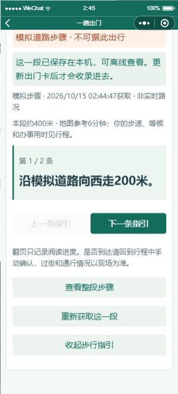

# 分段步行指引

入口保持在“一趟出门”的结果中：核算整趟行程 → 查看步行指引 → 选择路段 → 获取这一段。进行中的行程提供“查看剩余路段指引”，起点是最后一次本人确认的地点，不是自动取得的当前位置。

每次只取一段，先明确确认，再发送起终点。百度服务端AK仅由服务端读取；客户端不携带AK。没有后端时仍可查看模拟步骤和本机已保存的指引。没有步骤时保留原行程，不生成看似真实的导航。

## 阅读与离线使用

- 大字显示当前步骤，提供上一条、下一条及整段列表。翻页只改变阅读位置，不标记到达、不产生家人位置记录。
- 显示来源、获取时间、参考距离和服务商参考用时；个人步速、等候、购物和返程仍按原行程计算。日期不是道路核验日期。
- 最近6段保存在本机，按有向起终点编号、名称、坐标和坐标系匹配。位置变化后不会套用旧步骤。超过24小时或时钟异常时仍可查看，但明确提醒更新与核对。
- 获取后点击“准备这趟出门卡”，才把匹配路段收录进卡内；缺少的路段逐段标为“未获取”。刷新指引不会修改以前保存或下载的出门卡。
- Web可下载独立HTML，断网打开也能查看；该文件无脚本、远程资源或设备凭证。微信在本机出门卡中查看。文件或本机快照不随路况更新，也不自动发给家人。
- 存储失败时仅显示本次读取结果，并说明未完成离线保存。网络失败保留旧步骤，两端请求超时为35秒，不自动重试客户端请求。

过街、临时封路及入口开放情况以现场为准。当前是可离线阅读的文字指引，未实现定位跟随、偏航重算、路口到达检测或实时导航播报。模拟步骤来自与离线算路相同的道路图，包含河道绕行，但不能据此在现实中出行。

## 服务与额度

使用[百度轻量路线规划步行接口](https://lbsyun.baidu.com/docs/webapi?title=directionlite%2Fguide%2Fwebservice-lwrouteplanapi%2Fwalk)，服务端请求`steps_info=1`。同坐标系直接查询；不同坐标系时按需转换为BD-09，避免混用坐标。

与体检和办事矩阵共用BaiduGateway串行队列、日额度、配额失败停止机制及服务端120秒缓存。一次步行请求计1个route单位，提前保留1次重试余量；可能需要的坐标转换另计other。429与权限错误不重试，暂时网络错误至多重试1次。官方控制台的接口配额仍单独适用，本地预算不是账户余额。

真实地图测试脚本必须独占同一项目预算保护租约，已有真实地图服务运行时拒绝另起队列。手动运行：

```powershell
$env:CONFIRM_BAIDU_WALKING_LIVE='1'
node --env-file=.env --import tsx scripts/test-walking-live.ts
```

该脚本只查询上海公开地点的一段步行路，然后重复读取验证缓存。输入不含私人位置、电话或照片；详细响应存入忽略目录`.cache/walking-live.json`，不进仓库。脚本不会自动停止已有服务。

## 2026-10-15 验证

北京时间02:39，抚顺路社区睦邻中心（入口待核验）至阳普鞍山菜市场（鞍山四村店）的接口返回205米、194秒、4条步骤。重复请求使用缓存：百度实际请求1次，地点检索、转换和底图请求各0次。该记录仅证明接口及解析可用，没有完成街道实走或确认店铺入口。

157项业务／API／原生页面业务测试与25项浏览器流程通过。新覆盖包括缺失步骤、服务商HTML清理、坐标和编号绑定、预算不足、鉴权、拒绝确认、单请求保护、迟到响应丢弃、存储失败、旧步骤保留、断网回看及导出。修复真实百度设施编号含冒号被拒绝、私人地点的场景编号前缀导致入口文字未带入出门卡的问题。

通过微信官方CLI渲染构造的模拟路段核对原生排版，没有使用鼠标键盘控制，没有覆盖真实地点簿。首次自动化连接超时，在模拟器就绪后连接恢复；新增页面截图已检查，错误日志筛选无匹配。原生业务另由测试运行真实页面代码、模拟系统回调完成；新功能的实体手机与街道实测尚未完成。



